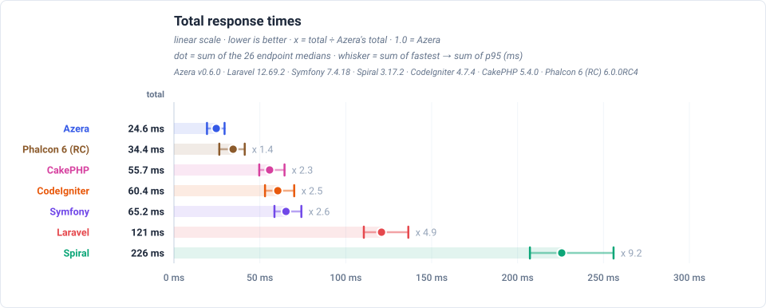
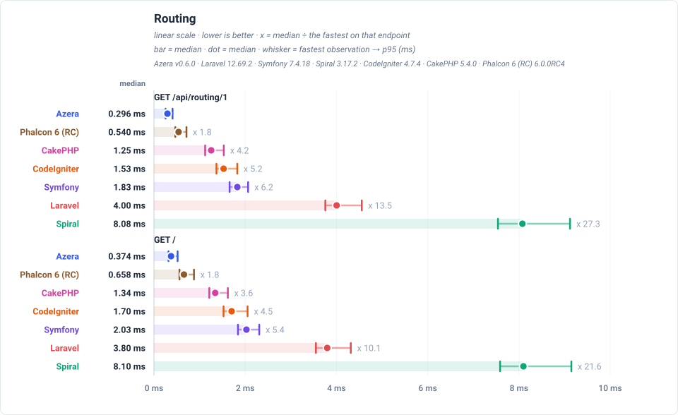
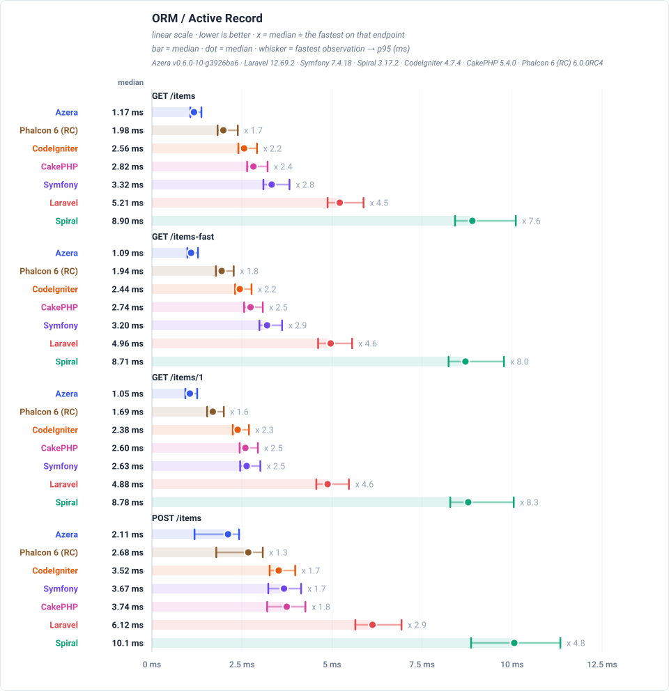
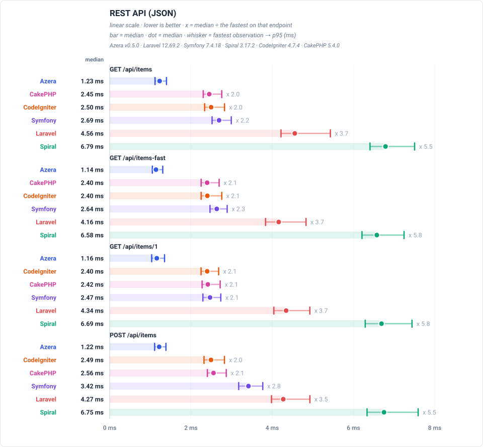
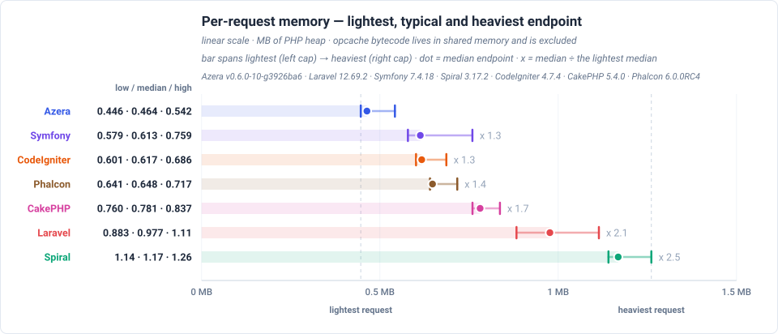

# Framework Competition — PHP-FPM Summary

The headline numbers from the measured nginx + PHP-FPM deployment: the cost of one pass over every endpoint, the plain routing request, the two data-access races, and what one request costs in memory. End-to-end HTTP over loopback, so the constant webserver overhead is included (see floor-http/floor-php in the dataset). The worker-recycling setting of the pool is stated with the server floor below, because it changes what each row contains.

**Environment** — PHP 8.5.11 · Linux 6.8.0-139-generic · OPcache: yes · JIT: tracing (buffer 64M) · 1000 iterations per run over 10 runs, lower is better.

**Frameworks** — Azera v0.6.0 · Laravel 12.69.2 · Symfony 7.4.18 · Spiral 3.17.2 · CodeIgniter 4.7.4 · CakePHP 5.4.0 · Phalcon 6 (RC) 6.0.0RC4.

_Measured 2026-11-24T18:27:42+00:00_

## Total response times

Total time to serve one pass over every benchmarked endpoint — each framework's sum of its endpoint medians, not a single response time — drawn relative to the baseline, so a row states how many times the baseline's own total it needed. Each endpoint's median is boot-inclusive occupancy for this view's deployment model, so the total is the worker time one pass over every endpoint costs. The chart orders the frameworks by that total and prints each one's multiplier beside its row.

## Feature benchmarks

One race per framework feature, each run as a real request against a real database. Each feature states the request it measures under its own heading. Every figure — the winner of each race and the margin over the runner-up — is in that feature's own chart below, which anchors each endpoint at its fastest framework.

### Routing
 `GET /api/routing/1` — matches a typed route and dispatches it to a constant handler — no template and no database access — so the band measures route matching and dispatch and nothing else. The endpoint sits in a deep bucket of the route table, which is where a compiled index actually saves work. `/echo` is drawn beside it: the same constant handler behind a STATIC route, i.e. the floor that route matching is measured against — and, like any floor, it is mostly the SERVER rather than the framework. Measured 2026-11-24 with `temp/echo-ab.php` on the bench VM, the entire framework layer on `/echo` costs single-digit microseconds, inside rows that print two to three orders of magnitude more. A difference of a few microseconds there is below the run-to-run spread, so read `/echo` as the common floor and NOT as a comparison between entrants; the charts that separate frameworks are the ones with real work in them.

### ORM / Active Record
 `GET /items` — loads one page of the 1,000 seeded rows through each framework's ORM / Active Record layer: 20 items plus a COUNT for the pagination total. The `-fast` band repeats that page with hydration switched off, so the cost of building one object per row can be read directly instead of inferred.

### REST API (JSON)
 `GET /api/items` — serves the same page of items as a JSON response rather than HTML, which adds serialization to the ORM work. The `-fast` band repeats that response with hydration switched off, so serialization cost and hydration cost can be told apart.

## Per-request memory

How much memory a single request needs, for every framework, measured inside the FPM worker that served it. The numbers come from the FPM worker process itself: because the entry script is torn down when the request ends, it appends one sample as it exits, and the harness reads that back. The pool is `pm = static` with `max_children = 1` and `max_requests = 0`, so this is ONE worker that stays alive for the whole block — which is why it has retained memory worth reporting at all.

A request's high-water mark is taken from the framework-ready boundary of the entry script to the moment the response is finished, with the mark reset at that boundary — so it counts exactly what serving the request cost, and never bleeds into the next one. Each endpoint was probed once, so the range shows how much the endpoints themselves differ — a property of the workload rather than of the measurement.

All six frameworks are drawn on one shared MB axis. The **left cap** is the lightest probed endpoint, the **dot** is the median endpoint, and the **right cap** is the heaviest. Every mark is a measured endpoint rather than an interpolation, so each can be named — the three numbers printed beside each bar are those same three readings. The faint bar behind each mark runs from zero to the median, so a row's length is read against the axis rather than estimated from the caps. The multiplier beside a row divides its median by the lightest median on the page; the reference row carries none.

Rows are ordered by the **median** request — a framework's typical cost — so one heavy route cannot reorder the table on its own. A row that stays flat and a row that reaches far right therefore say different things: the first is cheap on every route, the second is cheap on a typical request until one heavy route sets the worst case a pool has to be sized for.

## Latency by endpoint

Median in milliseconds, lower is better. **Bold** = fastest for that endpoint; a trailing `≈` = within the run-to-run noise band of the fastest, so read it as a tie rather than a defeat (`Tables::TIE_BAND` states the band and how it was calibrated). The median is the statistic the charts beside this table draw, so a cell and its bar are the same number; the dataset also carries a trimmed mean, which sits a few percent higher and ranks identically in all but two dead-heat cells, and it stays available for the outlier-robust cross-check rather than as a second published figure. Every number is END-TO-END per-request occupancy for the view's deployment model: the framework boot of that model is part of the cell, not parked in a separate chart. These are REAL deployments measured over HTTP: every row carries the constant server cost, which is why the values cluster — the floor note below states what stands under them. The workload column states what each request reads or writes. Every framework runs the same seeded database and the same page size, so the payload is identical no matter which framework served it; the workload column is the part of the suite that varies.

**Server floor** — measured nginx + PHP-FPM with `pm.max_requests=0`: the pool never recycles its worker, so no process is spawned per request — what remains is the FastCGI handshake plus a minimal script. A hello-world endpoint that boots nothing but PHP (`floor-php`) and a static file through nginx (`floor-http`) measure exactly that cost — the floor every row below stands on. Subtracting that floor leaves the framework's own per-request boot, which FPM still pays for every request even though its worker survives.

| Request | Workload | Azera | Laravel | Symfony | Spiral | CodeIgniter | CakePHP | Phalcon 6 (RC) |
|---|---|---:|---:|---:|---:|---:|---:|---:|
| `GET /api/routing/1` | no DB — typed route + constant body (routing only) | **0.296** | 4.00 | 1.83 | 8.08 | 1.53 | 1.25 | 0.540 |
| `GET /` | no DB — routing + template only | **0.374** | 3.80 | 2.03 | 8.10 | 1.70 | 1.34 | 0.658 |
| `GET /echo` | no DB — static route, constant body (throughput floor) | **0.252** | 3.66 | 1.75 | 8.01 | 1.54 | 1.22 | 0.545 |
| `GET /items` | 20 of 1000 items (page 1, + COUNT) | **1.15** | 5.23 | 3.24 | 8.85 | 2.53 | 2.69 | 1.86 |
| `GET /items-fast` | 20 of 1000 items (page 1, + COUNT), hydrated rows not built | **1.03** | 4.96 | 3.15 | 8.70 | 2.41 | 2.62 | 1.80 |
| `GET /items/1` | 1 item by id | **1.03** | 4.90 | 2.61 | 8.71 | 2.35 | 2.49 | 1.57 |
| `POST /items` | 1 row upserted (sentinel #999999) | **2.10** | 6.11 | 3.61 | 10.2 | 3.42 | 3.56 | 2.63 |
| `GET /items-qb` | 20 of 1000 items (page 1, + COUNT) | **0.960** | 4.81 | 2.28 | 8.49 | 2.39 | 2.11 | 1.23 |
| `GET /items-qb/1` | 1 item by id | **0.917** | 4.61 | 2.22 | 8.48 | 2.30 | 2.05 | 1.13 |
| `POST /items-qb` | 1 row upserted (sentinel #999997) | **1.87** | 5.70 | 3.20 | 9.72 | 3.38 | 3.06 | 2.14 |
| `GET /api/items` | 20 of 1000 items as JSON | **0.941** | 5.03 | 2.59 | 8.04 | 2.31 | 2.36 | 1.52 |
| `GET /api/items-fast` | 20 of 1000 items as JSON, rows not hydrated | **0.865** | 4.68 | 2.52 | 7.88 | 2.21 | 2.31 | 1.54 |
| `GET /api/items/1` | 1 item by id as JSON | **0.915** | 4.85 | 2.34 | 7.97 | 2.24 | 2.34 | 1.46 |
| `POST /api/items` | 1 row upserted (sentinel #999998) | **1.83** | 5.57 | 3.34 | 9.21 | 3.18 | 3.42 | 2.51 |
| `GET /features/aop` | 1 row upserted (sentinel #888800) | **1.78** | 5.19 | 2.93 | 9.66 | 3.20 | 2.69 | — |
| `GET /features/aop-direct` | 1 row upserted (sentinel #888800) | **1.76** | 5.20 | 2.94 | 9.54 | 3.20 | 2.69 | 1.85 |
| `GET /features/cache` | COUNT(*) of 1000 rows, cached 10s (miss = query) | **0.856** | 4.52 | 2.54 | 8.63 | 2.21 | 2.23 | 1.12 |
| `GET /features/log` | no DB — buffered log handlers | **0.379** | 3.73 | 1.87 | 8.30 | 1.62 | 1.25 | 0.651 |
| `GET /features/retry` | no DB — retry policy | **0.385** | 3.76 | 1.89 | 8.30 | 1.61 | 1.23 | 0.551 |
| `GET /features/pipeline` | no DB — middleware pipeline | **0.290** | 3.75 | 1.88 | 8.28 | 1.62 | 1.25 | 0.667 |
| `GET /features/db-events` | 1 row upserted (sentinel #888800) + COUNT(*), events collected | **1.83** | 5.54 | 3.66 | 9.83 | 3.39 | 3.39 | 1.99 |
| `GET /features/events` | no DB — in-process listeners | **1.75** | 5.22 | 2.97 | 9.54 | 3.30 | 2.70 | 1.97 |
| `GET /features/validation` | no DB — validator run | **0.289** | 4.66 | 2.20 | 8.35 | 1.96 | 1.64 | 0.719 |
| `GET /features/config` | no DB — config lookup | **0.258** | 3.74 | 1.86 | 8.23 | 1.63 | 1.23 | 0.599 |
| `GET /features/request-scoped` | no DB — scoped service resolve | **0.264** | 3.72 | 1.86 | 8.26 | 1.60 | 1.23 | 0.557 |
| `GET /features/rate-limit` | no DB — cache-backed limiter | **0.272** | 3.89 | 1.90 | 8.35 | 1.61 | 1.34 | 0.632 |

**Full comparison** — this page is a summary. The complete report, with every feature chart and the endpoint table for all six frameworks, is published at:

- The complete report (all seven frameworks, every feature chart) — <https://sailantis.github.io/azera-competition/benchmarks/>
- This model, measured end to end — <https://sailantis.github.io/azera-competition/benchmarks/view-real-fpm.html>
- The same work as a resident worker (Volucer) — <https://sailantis.github.io/azera-competition/benchmarks/view-summary-volucer.html>

---

> **Auto-generated.** This page and its charts are produced by the `azera-competition` repository:
> `php run.php --apps=azera,laravel,symfony,spiral,codeigniter,cakephp --warm --cold --seed --out=results/free-for-all-opcache-iso`
> then `php scripts/derive-fpm.php results/free-for-all-opcache-iso` and `php scripts/report.php --publish=framework`. Do not edit by hand — re-run the benchmark to update it.

Every chart is a plain SVG generated from the result JSON, so the numbers and the diagrams can never disagree.
